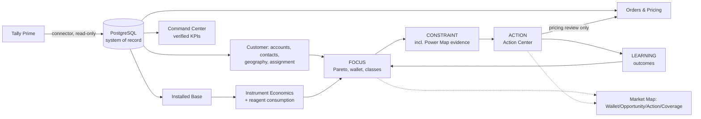

# Suprabha OS: overview

**Purpose:** a one-page orientation for a new engineer or coding agent.
**Status:** canonical. **Last verified:** 13 Oct 2026 (`main` `3804421`; RC `9cd36e0`).

## What it is
Suprabha OS is the operating system for Suprabha Distributors, a clinical-laboratory equipment, reagent and diagnostic-kit distributor in North Karnataka (Kalaburagi and nearby markets). StockFlow OMS is its first module. One application serves two purposes:
1. **Operational excellence:** orders, customers, Tally integration, billing hand-off, pricing, delivery, installations, service and instruments.
2. **Commercial intelligence:** profitable wallet capture, Pareto focus, power maps, instrument economics, market maps and capital allocation.

> One source of truth. No duplicate data. No silent failures. Every consequential event auditable. ACID-compliant transactions. Simple operations, disciplined architecture, measurable business value.

## Who owns what

| Tally Prime owns | Suprabha OS owns |
| --- | --- |
| Accounting, invoices, vouchers, ledgers | Orders and their workflow (capture → delivery) |
| Inventory: stock, batches, expiry, receipts, adjustments | Governed customer prices and approvals (Pricing Engine) |
| Purchase cost evidence | Installations, service tickets, installed-base register |
| Customer/product accounting identity | Placements, investment, attribution rules, expectations |
| | Commercial intelligence: wallet estimates, opportunities, constraints, actions, outcomes, stakeholder assessments |
| | Users, roles, audit history |

Suprabha OS **reads** Tally through the office connector. It never posts stock and never keeps a parallel ledger ([ADR-0001](06-DECISION-RECORDS.md)).

## What exists today
- **Operational V1** is built: orders end to end, pricing, roles, installations and service tickets, procurement requirements, offline drafts.
  - It is in production at roughly `main` level, but the **pilot is on HOLD**.
- **Instrument Economics** is in *acceptance*.
- **Commercial intelligence** is mostly *approved design*. A parked partial build exists on `claude/market-w1`.

See [IMPLEMENTATION-STATUS](../planning/IMPLEMENTATION-STATUS.md).

## How the intelligence connects

## Where to read next

| You need… | Read |
| --- | --- |
| Principles and the four engines | [01-PRINCIPLES](01-PRINCIPLES.md) |
| Domains and boundaries | [02-SYSTEM-AND-DOMAINS](02-SYSTEM-AND-DOMAINS.md) |
| Data and the ERD | [03-DATA-ARCHITECTURE](03-DATA-ARCHITECTURE.md) |
| The Tally contract | [04-TALLY-INTEGRATION](04-TALLY-INTEGRATION.md) |
| Write rules (ACID, audit, roles) | [05-SECURITY-ACID-AUDIT](05-SECURITY-ACID-AUDIT.md) |
| Why decisions were made | [06-DECISION-RECORDS](06-DECISION-RECORDS.md) |
| What to build next | [MASTER-ROADMAP](../planning/MASTER-ROADMAP.md) |

## How to build the next feature without breaking the architecture
1. Use the canonical customer ID and the existing roles and row scope. Never create a new master.
2. Write only through a gateway command: idempotency key, `expectedVersion`, `PT409` on conflict, and an audit event in the same transaction.
3. Never write stock or accounting. Reference Tally.
4. Every derived number carries its source, period, freshness and confidence. Missing stays missing.
5. Recommendations answer the seven questions in [01-PRINCIPLES](01-PRINCIPLES.md) and route price changes to the Pricing Engine.
6. Check [OPEN-DECISIONS](../planning/OPEN-DECISIONS.md) before assuming an answer.
