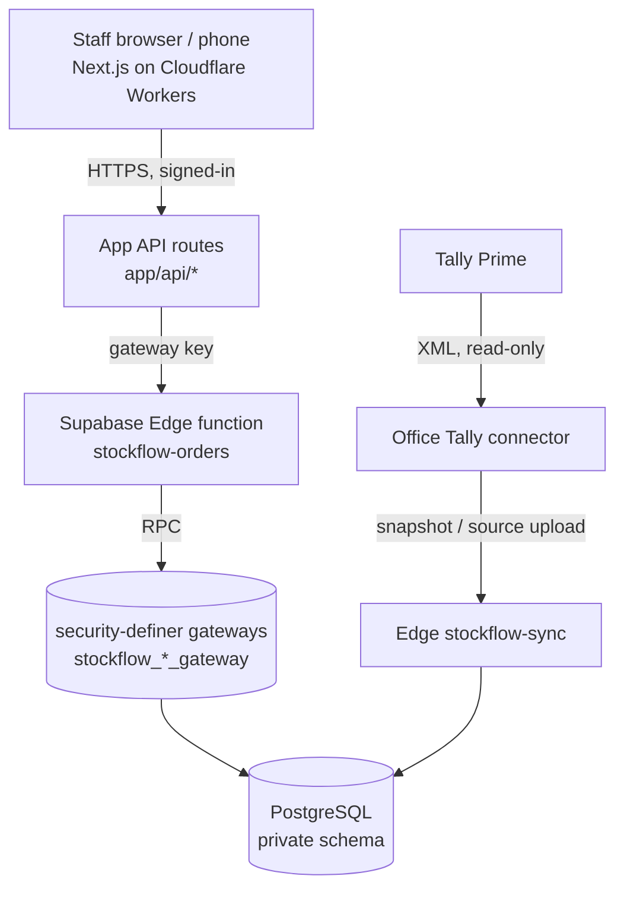
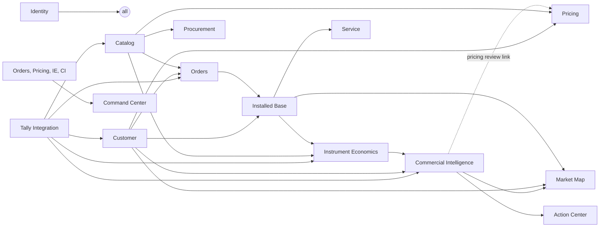

# System architecture and domain boundaries

**Status:** canonical.
**Sources:** [SUPRABHA_OS_ARCHITECTURE](../SUPRABHA_OS_ARCHITECTURE.md); spec §11; ADR-0002 and ADR-0011.
**Last verified:** 13 Oct 2026.

## 1. Runtime (as built)

- **Writes** happen only inside gateways. **Reads** use bounded read models.
- The browser never sees service credentials, and nothing in the browser connects to Tally.
- **Hosting:** production is Cloudflare + Supabase today. The alternatives are open ([D-06](../planning/OPEN-DECISIONS.md)).

## 2. Domains

| Domain | Kind | Owns | Must not |
| --- | --- | --- | --- |
| Identity & Access | authoritative | members, role sets, row scope | — |
| **Customer** | authoritative | accounts (Tally-linked; prospects proposed, ADR-0009), contacts *(gap)*, addresses/geography, owner/territory assignment *(gap)*, account classification | duplicate a customer per module |
| Catalog | authoritative (mirror of Tally identity) | items, pack/unit, item group → diagnostic division | invent items |
| Orders & Fulfilment | authoritative | capture, approval, billing hand-off, invoice identity match, dispatch, delivery, installations scheduling | post stock or invoices |
| Pricing | authoritative | price book, governed approvals, strategic price decisions | — |
| Procurement Requirements | authoritative | demand-linked requirements, references to Tally arrivals/PO/GRN | create stock or PO in parallel |
| **Installed Base** | authoritative | canonical instrument register: model, serial, site, ownership/commercial model, warranty/contract, service owner (unification proposed, ADR-0011) | — |
| Service | authoritative | tickets (visits/PM deferred) | — |
| Tally Integration | boundary | connector, snapshots, source vouchers/revisions, freshness, reconciliation | write to Tally automatically (not in the current phase) |
| Instrument Economics | derived | placements, investment events, attribution results, recovery, consumption and leakage cases | edit Tally actuals |
| **Commercial Intelligence** | derived + own decisions | wallet snapshots, opportunities, constraints, actions, outcomes, score snapshots and policies, stakeholder assessments, social-style observations | approve prices; copy contacts or geography |
| Management Intelligence | derived | KPI registry, Command Center | keep a manual parallel reporting database |
| Geographic read models | derived, disposable | map projections with watermarks | be a system of record |

**Cross-domain rule:**
- Mutations happen through one domain command in one transaction, or through an outbox event after commit.
- Derived domains **reference** authoritative IDs. They never copy them into their own masters.

## 3. Module dependencies

