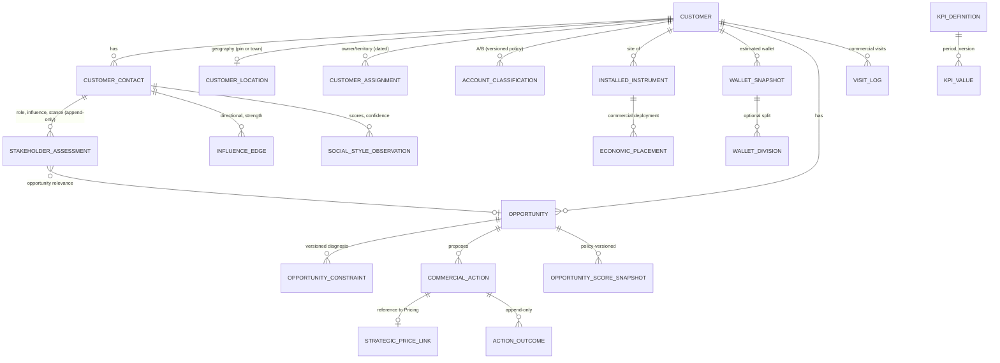

# Data architecture

**Status:** canonical. Existing tables come from the migrations on the RC (`9cd36e0`); future entities are design only.
**Sources:** `supabase/migrations/*`; spec §12; economics plan §7; ADR-0007 to ADR-0011.
**Last verified:** 13 Oct 2026.

## 1. Existing tables by domain (RC, `private` schema unless noted)

| Domain | Tables |
| --- | --- |
| Identity | `public.stockflow_members`, `stockflow_member_events`, `stockflow_role_permissions`, `stockflow_role_order_scopes` |
| Customer | `stockflow_customers` (Tally ledger key, name, phone, city, Tally balance) |
| Catalog / Tally mirror | `stockflow_products`, `public.stockflow_snapshots`, `stockflow_tally_sales_prices`, `stockflow_tally_purchase_costs` |
| Orders | `stockflow_orders`, `stockflow_order_lines`, `stockflow_order_events`, `stockflow_order_states`, `stockflow_order_transition_rules`, `stockflow_order_tally_invoices`, `stockflow_delivery_exceptions`, `stockflow_billing_snapshots`, `stockflow_product_requests` (+events) |
| Pricing | `stockflow_customer_product_prices`, `stockflow_standard_item_prices`, `stockflow_pricing_policies`, `stockflow_price_book_decisions`, `stockflow_price_exceptions`, `stockflow_order_pricing_decisions`, `stockflow_group_margin_item_decisions`, `stockflow_pricing_events`, `stockflow_pricing_import_runs` |
| Installations / Service | `stockflow_equipment_installations`, `stockflow_service_tickets` (+events) |
| Instrument Economics | `stockflow_economic_*` (targets, group members, mappings, item-group mappings, allocations, expectations (+items), policy versions, source vouchers/lines, runs, results, events, cost links/verifications, auto-cost links, acquisition links/reviews, instrument billings, import exceptions, line reviews, source coverage, customer identities, audit, consumption observations), `stockflow_leakage_cases`, `stockflow_leakage_recovery_claims` |
| Reliability | `stockflow_command_results` (idempotency), `stockflow_outbox`, `stockflow_request_log`, `stockflow_gateway_config` |
| **Dormant: superseded (ADR-0001)** | `stockflow_inventory_movements`, `stockflow_batches`, `stockflow_reservations`, `stockflow_warehouses`, `stockflow_locations`: no route, no UI; removal pending [D-05](../planning/OPEN-DECISIONS.md) |

On the parked branch `claude/market-w1` only, **not part of the canonical model until reworked**: `stockflow_customer_locations` (+events), `stockflow_wallet_divisions` (+events), `stockflow_wallet_estimates`.

## 2. Future entities (design only)

| Entity | Domain | Key rules |
| --- | --- | --- |
| `customer_contact` | Customer | business role and contact only; erasure by redaction (ADR-0018) |
| `customer_location` | Customer | exact pin or town level, with precision flag and source; versioned and audited (rework of `market-w1`) |
| `customer_assignment` | Customer | effective-dated owner/territory; drives row scope for sales |
| `installed_instrument` | Installed Base | one register ID; unifies installations and economic targets (ADR-0011) |
| `wallet_snapshot` / `wallet_division` | Commercial Intelligence | append-only; method, source, confidence, verifier, as-of; unallocated shown (ADR-0007) |
| `opportunity` (one entity) | Commercial Intelligence | capture/defend/recover; provenance and confidence (ADR-0008) |
| `opportunity_constraint` | Commercial Intelligence | one primary binding constraint; evidence; UNKNOWN allowed |
| `commercial_action` | Commercial Intelligence | state machine (spec §7); expected economics frozen at approval |
| `action_outcome` | Commercial Intelligence | append-only expected vs actual |
| `opportunity_score_snapshot`, `scoring_policy` | Commercial Intelligence | reproducible; drivers stored |
| `stakeholder_assessment`, `influence_edge`, `social_style_observation` | Commercial Intelligence | append-only; evidence, confidence, last verified |
| `visit_log` | Commercial Intelligence | visit purpose, outcome, next visit |
| `kpi_definition` / `kpi_value` | Management Intelligence | definition, source, formula version, period, refresh, owner, drill-down |

**Common columns for every future table:**
- UUID primary key;
- `version` (if mutable);
- created and updated by/at;
- no hard delete (trigger);
- audit events;
- effective dating where the business meaning changes over time.
