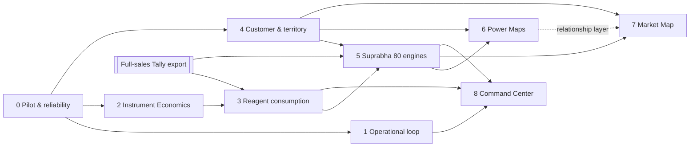

# Master roadmap (Phases 0–8)

**Status:** PROPOSED for owner approval (ADR-0010, [D-09](OPEN-DECISIONS.md)). Once approved, it replaces the milestone ordering in [ROADMAP.md](../ROADMAP.md) and R0–R5 in [REQUIREMENTS §7](../REQUIREMENTS-AND-DELIVERY-PLAN.md). Their deferrals and guardrails remain.
**Sources:** owner brief phases (13 Oct 2026); dependency checks against the repo ([IMPLEMENTATION-STATUS](IMPLEMENTATION-STATUS.md)).
**Last verified:** 13 Oct 2026.

**Rules:**
- No dates and no completion percentages.
- Effort figures are **relative complexity** plus indicative focused engineering days, assuming Codex implementation with Claude review. They exclude owner, Accounts and office time, and are re-estimated at each phase start.

## Dependency corrections (versus the brief's hypothesis)
1. **Full-sales Tally export** is a cross-cutting prerequisite for Phases 3, 5 and 7. Schedule it during Phase 1/2 (integration owner; plan drafted).
2. **Phase 4 must precede 5 and 6**, because contacts, assignment and row scope are needed by the scorecards and Power Maps.
3. **Phase 2 starts by unifying the installed-base register** (ADR-0011), before new instrument features.

---

## Phase 0: Operational V1 completion and office pilot
- **Objective:** a reliable, accepted operational core in production.
- **User benefit:** staff trust the system for daily orders.
- **Scope:**
  - release the current candidate (the integration owner merges to `main`);
  - verify deployed commit and migrations;
  - Tally company identity and freshness;
  - connector restart and retry;
  - order create, edit, bill, dispatch and deliver;
  - role restrictions and concurrent edits;
  - offline recovery and no duplicates;
  - **backup restore drill**;
  - office performance and billing impact;
  - **5-working-day pilot**;
  - fix P0/P1 only.
- **Reused:** everything built.
- **Missing:** restore evidence, device acceptance, pilot evidence.
- **Dependencies:** Accounts (LDL-C, 11 exceptions, sign-off), role sessions.
- **Database changes:** none planned. D-05 optionally adds an archival migration *after* the pilot.
- **APIs / UI:** none new.
- **Security / audit:** verify role and row scope live.
- **Testing:** the gates in [RELEASE-GATES](RELEASE-GATES.md) §0.
- **Complexity:** low (engineering); high (coordination).
- **Effort:** 3–8 engineering days of fixes.
- **Risks:**
  - pilot keeps slipping on speculative work (the brief says don't delay the pilot);
  - Android sign-in.
- **Exclusions:** new features.

## Phase 1: Operational loop closure
- **Objective:** fewer clicks; shortages are visible and traced to orders.
- **Scope:**
  - **customer-specific frequent products**;
  - repeat-order shortcuts (exist) and keyboard-first entry (exists);
  - pack/unit clarity;
  - minimal mandatory fields;
  - requirement consolidation without losing traceability;
  - duplicate prevention;
  - match Tally arrivals to open requirements and highlight orders that can now be fulfilled;
  - PO/GRN **references** to Tally;
  - delivery exceptions.
- **Reused:** requirements, waiting orders, stock-increase alerts, repeat order.
- **Missing:** frequent products; consolidation and arrival matching (depth unverified); PO/GRN references.
- **Dependencies:** Phase 0.
- **Data:** Tally snapshot freshness.
- **Database changes:** a frequent-products read model; requirement consolidation links.
- **APIs:** extend orders and requirements.
- **UI:** order capture, requirements.
- **Security / audit:** standard.
- **Testing:**
  - capture budget: customer + 3 products in 60 s;
  - duplicate-requirement prevention;
  - arrival matching.
- **Complexity:** medium.
- **Effort:** 8–15 days.
- **Risks:** treating advisory stock as available.
- **Exclusions:** no stock ledger; no automatic POs.

## Phase 2: Instrument Economics
- **Objective:** know what each placement earns and recovers, and govern new placements.
- **Scope:**
  - **unify the installed-base register** (installations + economic placements);
  - manufacturer, model, serial, site, ownership/commercial model, warranty/contract, supplier/purchase evidence, acquisition cost, placement investment, buyback/FOC/refurbished/transferred handling, salesperson and service owner;
  - expected vs actual reagent GP, recovery, payback, underperformers;
  - **approval routing by tier** (D-04);
  - manual investment entry with reason and audit.
- **Reused:** 15 economics migrations, the ABG pilot, policy versions.
- **Missing:** the unified register; tier routing; production cutover.
- **Dependencies:** Phase 0; Economics production cutover (integration owner).
- **Database changes:** the register table and links; an approval-routing command.
- **APIs:** extend `/api/instrument-economics`.
- **UI:** instrument register in Service/Economics; approval queue.
- **Security / audit:** finance roles; frozen approval baselines.
- **Testing:**
  - attribution reconciliation;
  - tier routing;
  - two-session approval race.
- **Complexity:** medium.
- **Effort:** 8–12 days.
- **Risks:** confusing acquisition cost, selling price and investment (kept separate).
- **Exclusions:** depreciation, NPV, IRR.

## Phase 3: Reagent consumption intelligence
- **Objective:** find underperforming placements and investigate the causes.
- **Scope:**
  - expected vs actual consumption and the gap;
  - trend;
  - monthly reagent GP;
  - potential leakage (an estimate);
  - payback deterioration;
  - explainable alerts and investigation tasks;
  - cause classification, never auto-"competitor".
- **Reused:** leakage cases and tab.
- **Missing:** portfolio-wide coverage (needs full sales); trends; alerts.
- **Dependencies:** Phase 2; **full-sales export**.
- **Database changes:** consumption read model; alert rules (versioned).
- **UI:** leakage queue.
- **Testing:**
  - supply-proxy flagging;
  - cause requires evidence;
  - no double-counting across windows.
- **Complexity:** medium.
- **Effort:** 6–10 days.
- **Risks:** presenting a supply proxy as consumption.
- **Exclusions:** automatic competitor labelling.

## Phase 4: Customer and territory intelligence
- **Objective:** canonical account context for all commercial work.
- **Scope:**
  - `customer_contact`;
  - `customer_location` (pin or town, verification and confidence);
  - `customer_assignment` (owner and territory) **with row scope for sales**;
  - prospects (ADR-0009);
  - account classification (versioned);
  - installed-equipment overlay data;
  - visit log (last and next visit);
  - competitor-equipment observations;
  - coverage queues.
- **Reused:** `claude/market-w1` pin backend (rework).
- **Missing:** everything else.
- **Dependencies:** Phase 0.
- **Database changes:** the new Customer-domain tables.
- **APIs:** customer and account endpoints.
- **UI:** Account page; coverage list.
- **Security / audit:** row scope; contact privacy (D-07).
- **Testing:**
  - row-scope denial;
  - no duplicate customer;
  - prospect-to-Tally linking.
- **Complexity:** medium–large.
- **Effort:** 10–15 days.
- **Risks:** a second customer master. Avoided by ADR-0009.
- **Exclusions:** automatic geocoding of customer data.

## Phase 5: Suprabha 80 / Pareto engines
- **Objective:** a small, explainable, economically ranked action list.
- **Scope:**
  - wallet snapshots (ADR-0007);
  - Suprabha revenue from full sales;
  - classes and stages;
  - FOCUS (Pareto levels, versioned focus band);
  - opportunities (ADR-0008);
  - CONSTRAINT diagnosis;
  - ACTION with EV cards;
  - Action Center queue;
  - LEARNING outcomes;
  - pricing-review links;
  - 80% Account Scorecard.
- **Reused:** `market-w1` estimates and screen (rework).
- **Dependencies:** Phases 3 and 4; full sales.
- **Database changes:** the Commercial Intelligence tables ([03-DATA](../architecture/03-DATA-ARCHITECTURE.md) §2).
- **APIs:** `/api/intelligence/*` (spec §13).
- **UI:** Action Center, Account workspace, Diagnosis, Outcome review.
- **Security / audit:** commercial roles; frozen baselines; append-only.
- **Testing:**
  - reproducible scores;
  - an EV card shows missing fields;
  - a price action only links to Pricing.
- **Complexity:** large.
- **Effort:** 20–30 days.
- **Risks:** false precision, which ADR-0014 guards against.
- **Exclusions:** AI ranking; automatic discounts; weighted composites before calibration.

## Phase 6: Stakeholder Power Maps and Social Styles
- **Scope:** [POWER-MAPS](../intelligence/POWER-MAPS.md).
- **Dependencies:** Phase 4 (contacts, assignment) and Phase 5 (opportunities).
- **Database changes:** assessments, edges, style observations.
- **UI:** graph plus list.
- **Testing:**
  - erasure by redaction;
  - "not enough information" default;
  - RELATIONSHIP constraint citation.
- **Complexity:** medium.
- **Effort:** 8–12 days.
- **Risks:** speculative profiling. Guarded by evidence plus confidence.
- **Exclusions:** psychological classification.

## Phase 7: Canonical Market Map
- **Scope:** [MARKET-MAPS](../intelligence/MARKET-MAPS.md): four modes, shared layers, a visit planner separate from delivery routing.
- **Dependencies:** Phases 4 and 5 (6 optional); full sales.
- **Database changes:** a geographic read model.
- **UI:** the map plus a shared drawer.
- **Testing:**
  - list/map parity;
  - no invented pins;
  - freshness.
- **Complexity:** medium–large.
- **Effort:** 10–15 days.
- **Risks:** decorative mapping. Guarded by the utility rule.
- **Exclusions:** combined routing objective.

## Phase 8: Command Center and optimisation
- **Scope:**
  - the [COMMAND-CENTER](../intelligence/COMMAND-CENTER.md) KPI registry and headline set;
  - capital allocation board (policy-versioned);
  - outcome dashboards;
  - forecasting *readiness* only.
- **Dependencies:** Phases 1, 3 and 5.
- **Complexity:** medium.
- **Effort:** 6–10 days.
- **Exclusions:** KPIs without verified data.

## Future (only when data quality and adoption justify)
- Governed receivables and collections (deferred by the owner, 13 Oct).
- Fuller procurement.
- Customer self-service.
- Salesperson mobile.
- Preventive service (parked, 13 Oct).
- Advanced routing.
- Forecasting.
- Recommendation assistance.
- Principal scorecards.
- The growth engines in [GROWTH-AND-SCALE-ARCHITECTURE](https://github.com/anilmahindrakar22-creator/Suprabha-Distributors/blob/839497a/docs/GROWTH-AND-SCALE-ARCHITECTURE.md).
- AI remains advisory.
